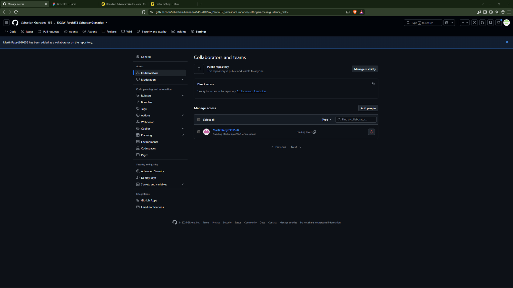
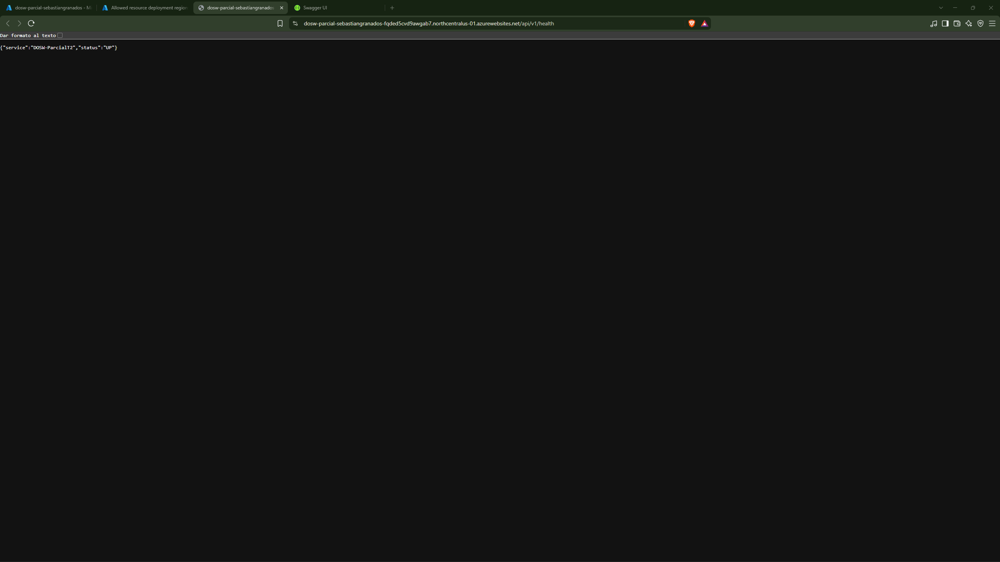
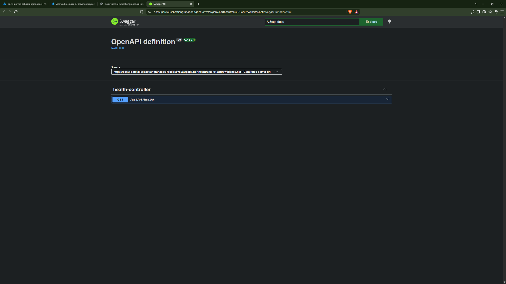
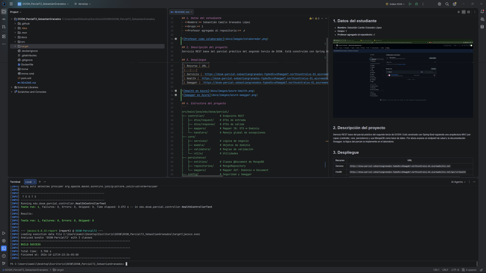
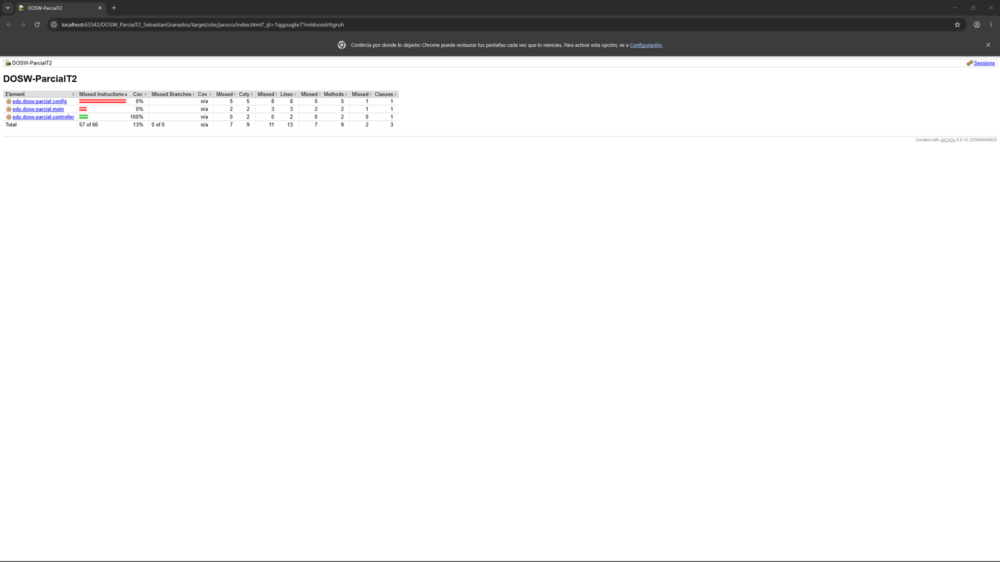
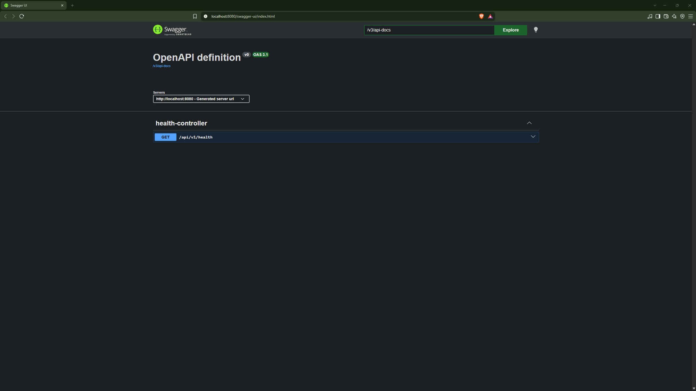
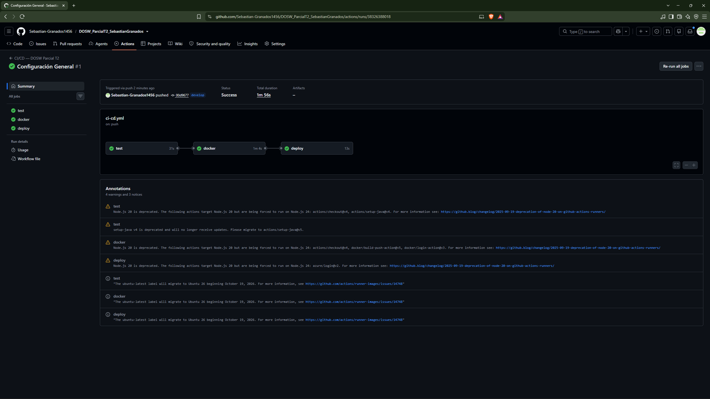
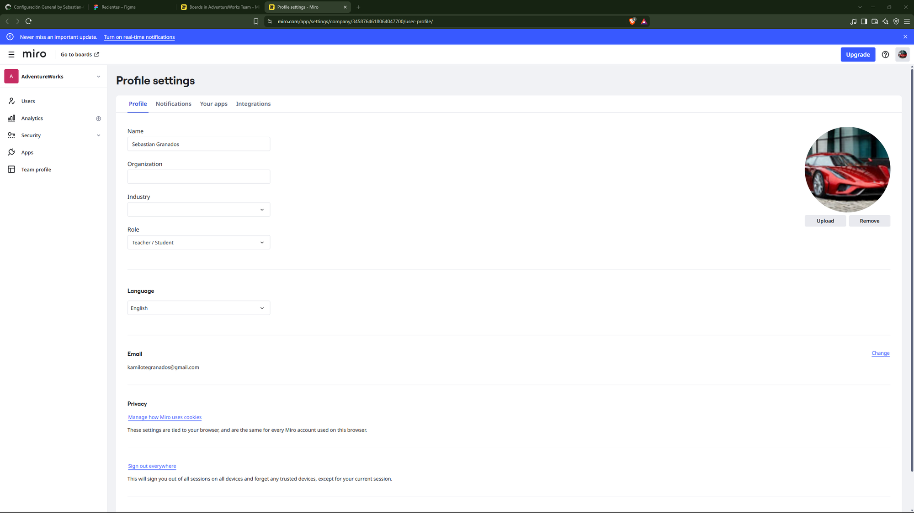
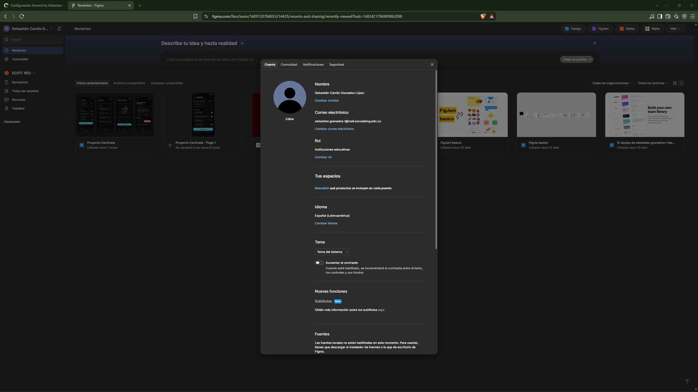

# DOSW_ParcialT2_SebastianGranados

## Realización Parcial
### Enunciado Rojo: Bob's Barber — Parte Teórica
**Estudiantes:** Sebastián Camilo Granados López - Juan David Munar Chaparro
- El README correspondiente con todas las respuestas: [Readme Teorico](docs/README.md)


---

## Índice
1. [Datos del estudiante](#1-datos-del-estudiante)
2. [Descripción del proyecto](#2-descripción-del-proyecto)
3. [Despliegue](#3-despliegue)
4. [Estructura del proyecto](#4-estructura-del-proyecto)
5. [Tecnologías y dependencias](#5-tecnologías-y-dependencias)
6. [Configuración y variables de entorno](#6-configuración-y-variables-de-entorno)
7. [Cómo ejecutar](#7-cómo-ejecutar)
8. [Pruebas](#8-pruebas)
9. [Docker](#9-docker)
10. [CI/CD](#10-cicd)
11. [Herramientas de modelado y diseño (evidencias)](#11-herramientas-de-modelado-y-diseño-evidencias)

## 1. Datos del estudiante
- **Nombre:** Sebastián Camilo Granados López
- **Grupo:** 1
- **Profesor agregado al repositorio:** ✔



## 2. Descripción del proyecto
Servicio REST base del parcial práctico del segundo tercio de DOSW. Está construido con Spring Boot siguiendo una arquitectura MVC por capas (controller, core, persistence) y usa MongoDB como base de datos. Por ahora expone un endpoint de salud y la documentación Swagger; la lógica del parcial se implementa en el laboratorio.

## 3. Despliegue
| Recurso | URL |
|---|---|
| Servicio | `https://dosw-parcial-sebastiangranados-fqded5cvd9awgab7.northcentralus-01.azurewebsites.net` |
| Health | `https://dosw-parcial-sebastiangranados-fqded5cvd9awgab7.northcentralus-01.azurewebsites.net/api/v1/health` |
| Swagger | `https://dosw-parcial-sebastiangranados-fqded5cvd9awgab7.northcentralus-01.azurewebsites.net/swagger-ui/index.html` |




## 4. Estructura del proyecto
```
src/main/java/edu/dosw/parcial/
├── controller/          # Endpoints REST
│   ├── dtos/request/    # DTOs de entrada
│   ├── dtos/response/   # DTOs de salida
│   ├── mappers/         # Mapper IN: DTO ↔ Dominio
│   └── handlers/        # Manejo global de excepciones
├── core/
│   ├── services/        # Lógica de negocio
│   ├── models/          # Objetos de dominio
│   ├── validators/      # Reglas de validación
│   └── utils/           # Utilidades
├── persistence/
│   ├── entities/        # Clases @Document de MongoDB
│   ├── repositories/    # MongoRepository
│   └── mappers/         # Mapper OUT: Dominio ↔ Document
├── config/              # Seguridad y Swagger
└── main/                # Clase principal @SpringBootApplication
```
- `docs/uml/`: diagramas fuente.
- `docs/images/`: capturas y evidencias del README.

## 5. Tecnologías y dependencias
| Tecnología | Versión | Uso |
|---|---|---|
| Java | 21 | Lenguaje |
| Spring Boot | 3.5.16 | Framework base |
| Spring Data MongoDB | (Spring Boot) | Persistencia |
| Spring Security + JJWT | 0.12.7 | Seguridad y JWT |
| Spring Validation | (Spring Boot) | Validación de DTOs |
| Springdoc OpenAPI | 2.8.17 | Swagger |
| Lombok | 1.18.48 | Reducir código repetitivo |
| MapStruct | 1.6.3 | Mappers |
| JUnit 5 + Mockito | (Spring Boot) | Pruebas |
| Jacoco | 0.8.15 | Cobertura |
| SonarQube | 3.10.0.2594 | Análisis estático |
| Docker | - | Contenedor |
| GitHub Actions | - | CI/CD |
| Azure App Service | - | Despliegue |

## 6. Configuración y variables de entorno
| Variable | Descripción | Ejemplo |
|---|---|---|
| `MONGODB_URI` | Cadena de conexión a MongoDB | `mongodb://localhost:27017/dosw_parcial` |
| `JWT_SECRET` | Secret JWT en Base64 (mínimo 44 caracteres) | `<secret_base64>` |
| `PORT` | Puerto del servicio (por defecto 8080) | `8080` |
| `WEBSITES_PORT` | Puerto que Azure enruta al contenedor | `8080` |

## 7. Cómo ejecutar
**MongoDB local con Docker**
```bash
docker run -d -p 27017:27017 --name mongo-parcial mongo:7
```

**Local con Maven**
```bash
export JWT_SECRET=<secret_base64>
mvn spring-boot:run
```

**Local con Docker**
```bash
docker build -t dosw-parcial:local .
docker run -p 8080:8080 -e JWT_SECRET=<secret_base64> dosw-parcial:local
```

## 8. Pruebas
```bash
mvn test
```
El reporte de cobertura queda en `target/site/jacoco/index.html`.




## 9. Docker
La imagen es multietapa: compila con Maven y luego corre el jar sobre `eclipse-temurin:21-jre-alpine`. Los comandos están en la [sección 7](#7-cómo-ejecutar).



## 10. CI/CD
El pipeline `.github/workflows/ci-cd.yml` se ejecuta con cada push a `main` y `develop`:
1. **test:** compila y corre las pruebas (`mvn verify`).
2. **docker:** construye la imagen y la publica en Docker Hub.
3. **deploy:** despliega la imagen en Azure App Service.

Secrets usados: `DOCKERHUB_USERNAME`, `DOCKERHUB_TOKEN`, `AZURE_CREDENTIALS`, `AZURE_WEBAPP_NAME`, `JWT_SECRET`.



## 11. Herramientas de modelado y diseño (evidencias)
**Miro**



**Figma**


