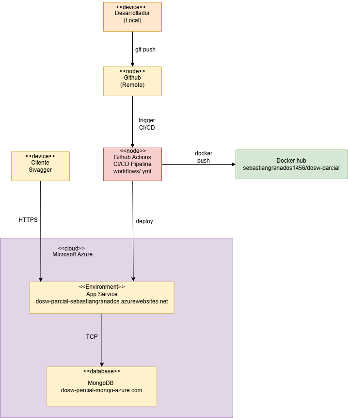

## Punto 1
### [Asignación el Equipo de Producto - Definición del contrato de la API.xlsx](Asignaci%F3n%20el%20Equipo%20de%20Producto%20-%20Definici%F3n%20del%20contrato%20de%20la%20API.xlsx)
- a. Para una validación de entrada por ejemplo se revisa la completitud de los datos, una de negocio puede ser por ejemplo que el barbero exista, otra de negocio es que se tenga 10 digitos en un número telefónico, que no haya más reservas en la misma hora también cumple como de negocio.
- b. La API se detiene en la primer validación que falla, solo respondiendo con error con el código y su mensaje, si falla no se crea la reserva, nos e asigna barbero ni mucho menos se cambia a OCUPADO. 

---

## Punto 2
### Diagramas:
1. Componentes general: [Diagrama](images/CompGen.png)
2. Componentes específico: [Diagrama](images/CompEspecifico.png)
3. Diagrama de clases: [Diagrama](images/DiagramaClases.png)

- a. El problema que aparece es que se genera acoplamiento, no se respetan las responsabilidades de las clases y pueden ocurrir errores de seguridad, ya que un controlador nunca debería saber qué es una BD ni manejar persistencia. Por ejemplo en reservas: el usuario interactúa con la API en el Controller, luego el Mapper IN recibe esa info y la pasa a modelo de dominio hacia el Service, ahí en Service se valida si todo está bien, y si es así pasa al Mapper OUT, que se entiende con el Repository para guardar dicha reserva en la BD.
- b. Un validador verifica que se cumpla alguna regla de negocio o entrada, un ejemplo es ValidadorReserva con la regla de pasar las 4 validaciones en cadena. Una utilidad es una clase de apoyo sin estado que puede reutilizarse en varias partes, ejemplo una clase de horarios para validar formatos de fechas y horas de los turnos. El servicio contiene la lógica de negocio detrás del controlador, un ejemplo es el servicio de crear reserva o el de ver mis reservas.
- c. El Mapper In es el encargado de trasnformar los datos que reciba el controller hacia el service. El mapper Out recibe de service los datos del dominio y los trasnforma para darselos a repository y luego ponerlos en la BD
- d. Tomando las 3 reglas del punto anterior

    1. Teléfono de 10 dígitos y correo @gmail.com: Se ejecuta al inicio en el Controller, porque si el dato viene mal escrito se rechaza de una vez.
    2. El barbero debe existir: Se ejecuta dentro del Service apoyándose en el Repository, porque necesita cruzar el Controller -> Mapper IN -> Service y consultar en MongoDB si el barbero está registrado ya que si no existe, lanza error.
    3. No se duplica barbero + fecha + hora: También se ejecuta en el Service junto con el Validator antes de mandar al Mapper OUT, porque debe preguntarle al Repository si ya existe ese turno en la BD. Si ya existe, detiene el proceso y arroja error.

---

## Punto 3
### Diagrama: 
1. Diagrama de bases de datos no relacionales: [Diagrama](images/nosql.png)

- Ventaja: Todo queda compacto en las consultas principales. Al embeber la reserva con el turno y los servicios, podemos obtener toda la información necesaria en una única operación de lectura rápida.
- Desventaja: Al manejar referencias entre colecciones separadas (como barberos y turnos/reservas) se requieren múltiples consultas si se quiere traer información cruzada, y en los datos que se copian o embeben puede existir algo de duplicación de información si luego toca actualizarlos.

---

## Punto 4
### Asignación del Equipo de Seguridad - Proteger el acceso y la información

a. 
  - Autenticación: Sirve para logins autenticación de usuarios en general, se utiliza al hacer un POST en login y es donde se utiliza el token generado al hacer la autenticación arriba para el id, uno JWT. 
  - Autorización: Sirve para establecer permisos de acceso a los usuarios, es decir, que puede hacer cada usuario según su rol. Permitiendo o denegando el acceso a recursos e información sensible, podemos aplicarlo en turnos ya que ADMIN y CLIENTE necesitan de este para saber que es lo que puede acceder cada usuario, se limita a que el cliente solo puede ver y observar las suyas propias 
  - Integridad: Sirve para establecer que los datos no se modificaron o alteraron al momento de transmitirlos o almacenarlos, si usamos tokens JWT garantizamos que los datos como el Id de un Turno no se altera y que su contenido no fue alterado, puede que hayan personas que intenten cambiarlo, lo que hace que la propia firma deje de servir y se rechace.

b. Dos posibles riesgos según OWASP TOP 10 son los siguientes:
 - Identification and Authentication Failures: Es posible que dejar muy ambigua la identificación y Login de un usuario como lo es admin@gmail.com o cliente@gmail.com puede facilitar ataques de fuerza bruta, esto se puede mitigar creando diferentes usuarios al implementar más seguridad en el login y autenticación, como usando tokens que expiren, pero con el token se mitigan varios problemas. Si creamos cuentas independientes y personalizadas verificamos que no haya debilidad en esta confirmación del usuario cuando generamos el token y la contraseña especifica.
 - Broken Access Control: Puede ser posible que haya usuarios como Clientes puedan acceder a recursos solo para Admin, se mitiga directamente con la autenticación por token, algo presente en JWT, así verificamos que la autenticación para cada usuario tiene el token correspondiente con los permisos de su tipo.

c. Para la autenticación el más adecuado para garantizar seguridad es el de JWT o JSON Web Token en autenticación es el más adecuado ya que se tienen dos tipos de usuario con permisos diferentes, Cliente y Admin, cuando se tienen varios tipos de usuario es necesario que en cada petición se sepa quien es y que puede hacer, así es más sencillo y suficiente.

---

## Punto 5
### Asignación del Equipo de Calidad - Definir cómo comprobar el comportamiento.

- Cada vez que se crea un nuevo objeto se debe crear un test que primero falle por falta de implementación (RED), se implemente el código mínimo con el funcionamiento básico para que pase (GREEN), y por último se refactorice el código sin cambiar su comportamiento así verificando que las pruebas sigan pasando (REFACTOR).
- En Pedir un Turno se tienen varios escenarios, reserva exitosa CONFIRMADA (donde el turno pasa a OCUPADO), sin barbero elegido (donde se le asigna uno por especialidad) y un rechazo por cada error.
- Se comprueba el orden de la siguiente forma, se crean pruebas que fallen en dos validaciones a la vez, por ejemplo, franja llena y nombre vacío, en el cual responde con un rechazo de error E01 y no E03 por ejemplo.
- La forma de comprobar que una falla no deja cambios es revisar que no se guarda la reserva y el turno se mantiene DISPONIBLE.

a. Se puede hacer que cada prueba sea una regla del caso, ahí directamente se agrega la caracteristica de que si pasa despues de implementar Refactor es porque esa regla efectivamente se cumple. Con pruebas que son unitarias, hay que verificar cada validador por separado, en general la lógica de servicio, el cálculo del servicio total y la asignación final del barbero.

b. No, no van a mostrar directamente por si solas la ausencia de errores, lo único que garantizan es que no haya errores en los casos específicos que se prueban, también puede pasar que haya casos que no pensamos como pruebas. Claramente ayuda a que los implementados como pruebas tengan menos errores al recorrer todo el esquema TDD, pero estos no garantizan a la final que los errores no existan en otras partes. 

---

## Punto 6
### Asignación del Equipo de Devops 

- a. Las etapas principales del pipeline CI/CD son:
  1. test: Compila el código con Maven y corre las pruebas unitarias con JUnit, Mockito y JaCoCo. Su propósito es validar que la lógica y las reglas del negocio funcionen bien antes de seguir.
  2. docker: Crea la imagen del proyecto con el Dockerfile y la sube a Docker Hub. Su propósito es empaquetar la aplicación lista para correr igual en cualquier entorno.
  3. despliegue: Se conecta con Azure App Service y actualiza el contenedor con la nueva imagen de Docker Hub para dejar los cambios funcionando en producción, en este caso para que se pueda acceder al swagger.

- b. Si una prueba falla, el pipeline se detiene de inmediato en la etapa de pruebas y da error. No debe permitirse el despliegue porque las demás etapas dependen de que los tests pasen primero, además si dejáramos desplegar con pruebas rotas, subiríamos errores a producción (como permitir una cuarta reserva en la misma hora).

- c. Los logs sirven para llevar el rastro de lo que hace la API por dentro y poder investigar rápido por qué falló algo sin tener que frenar la aplicación. Para investigar una reserva fallida registraríamos qué validación de la cadena falló (por ejemplo E01 franja llena o E02 especialidad incompatible), la fecha/hora del turno y el barbero solicitado; y para un error de autenticación registraríamos el correo que intentó iniciar sesión y si falló por usuario no encontrado o credencial inválida.

- d. 
  - Ejemplos de información útil para rastrear la operación: La fecha y hora exacta, el nivel del log (INFO, WARN, ERROR), el endpoint llamado (ej. POST /api/v1/reservas), el ID del turno y el código de rechazo de negocio.
  - Datos que NO deben registrarse: Nunca se deben guardar en logs las contraseñas de los usuarios, el token JWT completo, la clave secreta JWT_SECRET ni la URL de Mongo con las credenciales de la BD.

- e. La diferencia es que el log interno es para los desarrolladores y tiene detalles técnicos como el nombre de la clase, el método que falló y la traza completa del error. En cambio el mensaje que recibe el cliente en el JSON de respuesta debe ser corto, facil de entender y seguro (ej. "El barbero seleccionado no tiene la especialidad requerida" con su código HTTP), sin mostrar nunca nombres de clases de Java, rutas del servidor ni errores internos de la BD por seguridad.